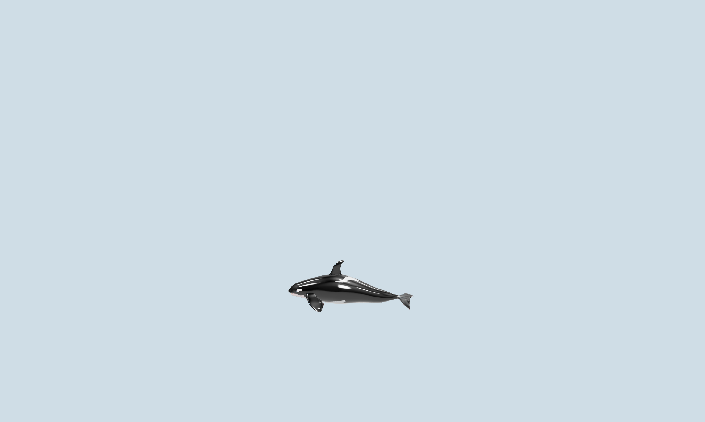

# Orca Desktop Pet 🐋

> This orca was a desktop pet built for fun, because of my love for orcas.

A small, glassy orca that swims across your desktop. She floats above your windows on a
transparent, click-through overlay, rests in the corners when you're working, does the
occasional barrel roll, and carries a little Spotify card when you click her.



---

## What she does

| Action | What happens |
| --- | --- |
| **Single click** | A translucent glass card appears and she stays where she is, looking around |
| **Single click again** | The card closes and she swims off again |
| **Double click** | Barrel roll — belly toward you, nose over tail |
| **Right click** | Releases her (same as a second click) |
| **Click and drag** | Pick her up and put her anywhere on screen |
| **Tray icon → Quit** | Closes the app |

She rests near corners about 80% of the time so she doesn't get in the way, swims in slow
circles and figure-eights across the screen otherwise, and her tail beat speeds up when she
swims faster and slows to a drift when she's resting.

---

## Install on Windows

1. Download **`OrcaPet.exe`** from the [Releases](../../releases) page.
2. Put it anywhere you like — Desktop, `D:\Apps`, doesn't matter. There's no installer.
3. Double-click it. She appears in the bottom-right of your screen.
4. Windows SmartScreen may say *"Windows protected your PC"* — that's normal for an unsigned
   indie app. Click **More info → Run anyway**.
5. To close her: right-click the **orca icon in the system tray** → **Quit Orca**.

That's it. Nothing to configure, no account, no network calls.

---

## Install on macOS

macOS builds have to be produced on a Mac (Apple doesn't allow cross-compiling the app
bundle from Windows), so there's no ready-made `.dmg` in Releases unless one is added later.
Building it yourself takes about two minutes:

1. Install **Node.js 20 or newer** — <https://nodejs.org> (pick the LTS installer).
2. Open **Terminal** and check it worked:
   ```bash
   node -v
   ```
3. Clone the repo and install dependencies:
   ```bash
   git clone https://github.com/unihemisphericorca/orca-desktop-pet.git
   cd orca-desktop-pet
   npm install
   ```
4. Build the app bundle:
   ```bash
   npm run dist:mac
   ```
5. The finished app lands in `dist/mac-arm64/Orca Pet.app` (or `dist/mac/` on Intel).
   Drag it to your **Applications** folder and open it.

First launch will be blocked by Gatekeeper because the app isn't signed: right-click the
app → **Open** → **Open** again. After the first time it opens normally.

**macOS permissions:** you may need to allow the app under
**System Settings → Privacy & Security → Accessibility** for the overlay to float above
other windows. Clicking through empty space works out of the box.

---

## Spotify (optional)

The glass card can show what you're playing and control it. This needs your own Spotify
Client ID — about three minutes of setup, and it's free.

**Spotify requires this because the app never sees your password.** You log in on
Spotify's own website; the app just receives permission to read your playback. No client
secret is used or stored, which is the correct (and only sensible) pattern for a desktop
app — anyone can unzip an `.exe`, so shipping a secret in it would leak it.

### Step 1 — Create a Spotify app

1. Go to <https://developer.spotify.com/dashboard> and log in with your normal Spotify account.
2. Accept the developer terms if prompted.
3. Click **Create app**.
4. Fill in:
   - **App name:** `Orca Pet` (anything you like)
   - **App description:** `Desktop pet that shows what I'm listening to`
   - **Redirect URI:** `http://127.0.0.1:8888/callback`
     ⚠️ **This exact string.** No trailing slash, `http` not `https`, port `8888`.
     If it doesn't match character for character, Spotify refuses to redirect back and
     you'll sit on an error page.
   - **Which API/SDKs:** tick **Web API**
5. Save.

### Step 2 — Copy your Client ID

1. Open your new app → **Settings**.
2. Copy the **Client ID** (32-ish characters).
3. Ignore **Client secret** — this app doesn't use it. Never put it anywhere.

### Step 3 — Tell the app your Client ID

Create a file named **`spotify.json`** in the **same folder as `OrcaPet.exe`**
(or in the project folder if you run from source):

```json
{
  "clientId": "paste-your-client-id-here"
}
```

There's a template in the repo: `spotify.json.example`.

### Step 4 — Connect

1. **Quit** the app from the tray (the orca icon → Quit Orca) and start it again — it reads
   `spotify.json` at launch.
2. Right-click the tray icon → **Connect Spotify…**
3. Your browser opens Spotify's consent page. Click **Agree**.
4. The browser shows **"Orca is connected"** — close that tab.

The token is saved as `spotify-token.json` next to your config, so you only do this once.
To revoke, use tray → **Disconnect Spotify**, and remove the app at
<https://www.spotify.com/account/apps/>.

### What works on which account

- **Free account:** the card can show the current track and artwork.
- **Premium:** the play/pause, next and previous buttons work. Spotify restricts playback
  control to Premium — on a free account the card will say **"Premium required"** rather
  than pretending the click worked.
- **Nothing playing:** the card says "Nothing playing" and never invents a track.

### Troubleshooting

| Symptom | Cause |
| --- | --- |
| Card says "Add spotify.json, then connect" | The file is missing or the key is spelled wrong |
| Browser shows `INVALID_CLIENT: Invalid redirect URI` | The Redirect URI in the dashboard isn't exactly `http://127.0.0.1:8888/callback` |
| Nothing happens on "Connect Spotify…" | Another program is using port 8888 — change the port in both `spotify.js` and the dashboard |
| Card says "Reconnect needed" | The refresh token expired or was revoked — Disconnect, then Connect again |

---

## Run from source (any OS)

```bash
git clone https://github.com/unihemisphericorca/orca-desktop-pet.git
cd orca-desktop-pet
npm install
npm start
```

---

## How she's built

- **Electron** for a transparent, frameless, always-on-top overlay with per-region
  click-through — a normal browser tab cannot float above other applications.
- **Three.js** for the 3D orca, loaded from a GLB with its own PBR textures.
- **A tiny state machine** (`swim`, `patrol`, `rest`, `circle`, `face`, `roll`, `drag`) with
  critically-damped springs instead of animation clips, so transitions never snap.
- **A vertex shader** carries the swim stroke: a travelling wave weighted toward the tail
  flukes, its rate and amplitude driven by her actual speed.
- **HTML/CSS** for the glass music card, so the text stays crisp and the blur is real
  `backdrop-filter` rather than a rendered texture.

The swimming model follows real cetacean mechanics: forward-only propulsion, a vertical
(dorsoventral) tail stroke, head-led turning, and no backwards movement ever.

---

## Credits

The orca model is **"Orca Killer Whale" by Lippanen** on Sketchfab, licensed
**CC BY 4.0** — attribution is required and is shown in the app's tray menu.

- Author: <https://sketchfab.com/jaakko.itapalo.edu>
- Source: <https://sketchfab.com/3d-models/orca-killer-whale-7c01c438ff03401d8e77127154c041c7>
- Licence: <https://creativecommons.org/licenses/by/4.0/>

The dorsal fin was gently rounded from the original mesh; the rest of the geometry is
untouched.

---

## Fine print

- The Spotify card needs **your own Client ID** (see the Spotify section above). Until it's
  connected it says so rather than inventing a track.
- Multi-monitor support is not implemented; she lives on the display the app starts on.
- She's an unsigned build, so both Windows and macOS will warn on first launch. That's
  expected, not a sign anything is wrong.
